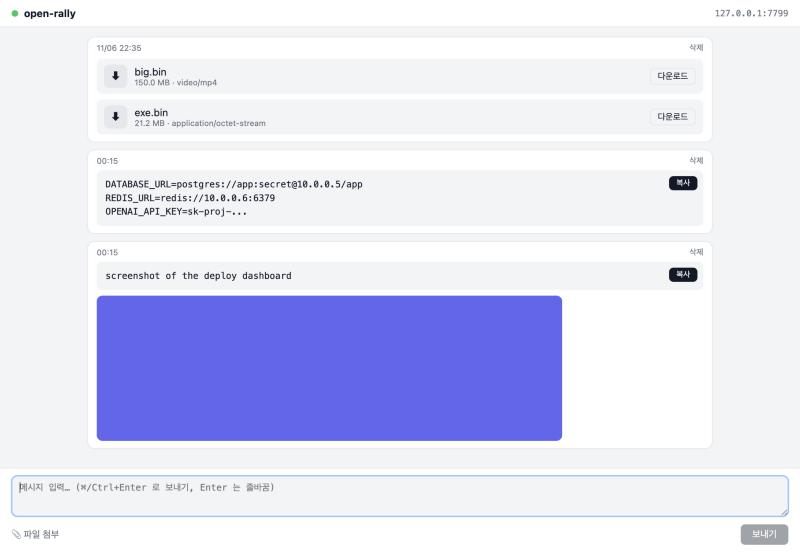

# open-rally

> 내 PC 들 사이에서 비밀값과 파일을 주고받기 위한 작은 공용 게시판. LAN 이나 Tailscale 안에서 쓰고, 비밀번호 하나만 치면 되며, Rust 바이너리 하나로 돈다.

[English README](README.md)



## 왜 만들었나

PC 를 여러 대 관리하다 보면 `.env`, API 키, 빌드 결과물, 화면 녹화를 한쪽에서 다른 쪽으로 옮길 일이 자주 생긴다. Slack 이나 메신저는 PC 마다 로그인을 요구하고, AirDrop 은 Apple 기기끼리만 되고, scp 는 키와 경로를 알아야 한다.

open-rally 는 그 사이에 있는 도구다. 같은 사설망의 어떤 기기든 브라우저로 열 수 있는 페이지 하나, 기기마다 한 번만 입력하는 비밀번호 하나. 텍스트를 붙여넣고 파일을 끌어다 놓으면 다른 쪽에서 복사하거나 내려받는다.

## 기능

- **텍스트·이미지·영상·아무 파일** 을 시간순 게시판 하나에. 텍스트는 공백과 줄바꿈을 그대로 보존하고 복사 버튼이 붙는다. 이미지는 인라인 미리보기, 영상은 브라우저가 틀 수 있으면 인라인 재생, 나머지는 다운로드 카드.
- **실시간 반영** (WebSocket). 한 PC 에서 올리면 다른 PC 화면에 새로고침 없이 뜬다.
- **공용 비밀번호 하나**, 브라우저마다 30일 기억. 계정 없음.
- **단일 바이너리.** 웹 UI 가 바이너리 안에 들어 있고 SQLite 도 번들된다.
- **macOS 메뉴바 앱** 으로 서버를 켜고 끈다. 꺼져 있으면 아무것도 듣지 않고 아무것도 쓰지 않는다.
- **Docker 이미지** 로 상시 서버(NAS, 홈서버, Docker Desktop)에도 올린다.
- **첨부 자동 정리.** 메뉴나 설정에서 기간(1·7·30·90일, 또는 끄기)을 고르면 그보다 오래된 첨부 파일을 매시간 지운다. 글과 텍스트는 남고 첨부는 "자동 정리로 삭제됨"으로 표시된다.
- **기본이 비공개.** Tailscale 인터페이스와 localhost 에만 열리고, LAN 공개는 명시적 토글이다. Host/Origin 허용 목록으로 브라우저 경유 CSRF 와 DNS rebinding 을 막는다.
- **스트리밍 업로드.** 1 GB 영상을 올려도 메모리가 1 GB 늘지 않는다.

## 빠른 시작

### macOS 메뉴바 앱

```bash
git clone https://github.com/GenesisSam/open-rally.git
cd open-rally
bash scripts/bundle-app.sh       # cargo build --release + dist/open-rally.app
open dist/open-rally.app
```

메뉴바에 채워진 원이 뜨고 서버가 켜진다. 메뉴에서 다른 PC 가 열 주소를 보고 복사하거나, 브라우저로 열거나, 서버를 끄고 켜거나, LAN 에 공개하거나, 비밀번호 파일을 열 수 있다.

### Docker (상시 서버)

```bash
docker build -t open-rally .
docker run -d --name open-rally --restart unless-stopped \
  -v open-rally-data:/data \
  -e OPEN_RALLY_PASSWORD='비밀번호' \
  -p 100.100.100.100:7777:7777 \
  open-rally
```

`100.100.100.100` 을 호스트의 Tailscale IP 로 바꾼다. 컨테이너 자체는 모든 인터페이스에 열리므로 호스트 쪽 바인딩 IP 가 LAN 노출을 막는 유일한 장치다. 같은 구성의 `docker-compose.yml` 이 들어 있다.

### 서버만, 아무 OS

```bash
cargo run --release -- --serve                 # Ctrl+C 로 종료, --lan 을 붙이면 LAN 공개
cargo build --release --no-default-features    # 트레이 의존성 없는 headless 바이너리
```

## 사용법

1. 다른 PC 에서 `http://<tailscale-ip>:7777` 을 연다.
2. 비밀번호를 넣는다. 데이터 폴더의 `config.toml` 에 있거나, `OPEN_RALLY_PASSWORD` 로 넘긴 값이다.
3. 텍스트를 입력하거나 붙여넣고 **⌘/Ctrl + Enter**. 파일은 페이지 아무 데나 끌어다 놓거나, 클립보드 이미지를 붙여넣거나, 첨부 버튼을 쓴다.
4. 받는 쪽에서 텍스트는 **복사**, 파일은 **다운로드**. 글은 직접 지울 때까지 남는다.

## 설정

| 변수 | 기본값 | 뜻 |
|---|---|---|
| `OPEN_RALLY_PORT` | `7777` | 리스닝 포트 |
| `OPEN_RALLY_DATA_DIR` | macOS `~/Library/Application Support/open-rally`, Linux `~/.local/share/open-rally`, Windows `%APPDATA%\open-rally`, Docker `/data` | DB·업로드·`config.toml` 위치 |
| `OPEN_RALLY_PASSWORD` | 없음 | 있으면 `config.toml` 대신 쓴다 |
| `OPEN_RALLY_RETENTION_DAYS` | 없음 | 이 일수보다 오래된 첨부를 삭제 (`0` 이거나 없으면 영구 보관). `config.toml` 의 `retention_days` 보다 우선 |

데이터 폴더에는 `open-rally.db`(SQLite), `uploads/<글 id>/<파일명>`, 그리고 `config.toml` 이 있다.

```toml
password = "..."        # 첫 실행 때 생성. 바꾼 뒤 서버를 다시 켜면 반영
retention_days = 7      # 선택. 메뉴바의 "첨부 자동 정리" 하위 메뉴가 이 줄을 쓴다
```

정리는 서버가 켜질 때, 기간을 바꿀 때, 그 뒤 매시간 돈다. 파일만 지우고 글은 텍스트와 함께 남으며 첨부는 정리됨으로 표시된다.

## 보안 모델

한 사람의 사설망용 도구이지 공개 서비스가 아니다. 무엇을 하고 무엇을 하지 않는지 알고 쓰자.

- **네트워크 범위.** 기본은 `127.0.0.1` 과 Tailscale 인터페이스(`100.64.0.0/10`). "LAN 에도 공개" 는 앱을 다시 켤 때까지 `0.0.0.0` 에 연다. 인터넷에 여는 모드는 없다.
- **비밀번호.** 공용 비밀번호 하나, 상수 시간 비교. 5회 틀리면 그 IP 를 10초 차단. 세션은 256비트 무작위 토큰이고 메모리에만 있어 서버를 다시 켜면 모두 로그아웃된다.
- **전송.** 평문 HTTP. 비밀번호는 같은 망의 누군가가 우연히 들어오는 것을 막지, 패킷을 보는 사람은 막지 못한다. 그래서 Tailscale 이 기본이다.
- **브라우저 경유 공격.** 모든 요청의 `Host` 가 사설/Tailscale/`.local`/`.ts.net` 허용 목록에 있어야 하고(아니면 `421`), 상태를 바꾸는 요청의 `Origin` 도 허용 목록 안이어야 한다(`403`). 접속 PC 의 다른 탭에서 오는 CSRF 와 DNS rebinding 을 막는다.
- **첨부.** 파일명은 정제되고 URL 로 경로를 만들지 않는다. SVG·HTML·XHTML 은 항상 `nosniff` 다운로드로만 내려주어 게시판 origin 에서 스크립트가 돌 수 없다.
- **범위 밖.** HTTPS, 계정, 저장 암호화, 로그인 외 속도 제한, 감사 로그.

## 구조

```
┌──────────────── 프로세스 하나 ───────────────┐
│  tao 이벤트 루프 (메인 스레드, 메뉴바)        │
│      │ 켜기 / 끄기                            │
│  ServerController ──► tokio 런타임           │
│      axum 라우터: /, /api/*, /files/*, /ws   │
│      rusqlite  ·  uploads/ 디스크            │
└─────────────────────────────────────────────┘
```

- `src/server/` — 라우터, 미들웨어(host, origin, session), 핸들러, WebSocket 브로드캐스트, `ServerController`(바인딩, 5초 상한의 graceful stop).
- `src/db.rs` — `posts`, `attachments` 두 테이블. ULID 키라 정렬이 `ORDER BY id` 로 끝난다.
- `src/files.rs`, `src/net.rs`, `src/auth.rs` — 단위 테스트가 붙은 순수 함수들: 파일명 규칙, 허용 목록, 세션과 속도 제한.
- `src/tray.rs` — 메뉴바 앱. `tray` cargo feature 뒤에 있다.
- `assets/` — 프론트엔드 전부. HTML 하나, CSS 하나, JS 하나, 빌드 없음, 인라인 스크립트 없음(CSP).

이 코드를 만든 설계 문서와 구현 계획은 [`docs/superpowers/`](docs/superpowers/) 에 있다.

## 개발

```bash
cargo test                          # 단위 + API + 실소켓 WebSocket 테스트
cargo test --no-default-features    # 트레이 없이 같은 테스트
cargo run -- --serve                # 개발 서버; http://127.0.0.1:7777
```

통합 테스트는 실제 라우터를 `tower::oneshot` 으로, WebSocket 은 실제 리스너로 돌리고 테스트마다 임시 폴더를 쓴다. 목(mock) 은 없다.

## 기여

이슈와 PR 을 환영한다. 환경 구성, 좋은 PR 의 모양, 프로젝트가 지키는 몇 가지 규칙(테스트 먼저, 이유 없는 런타임 의존성 추가 금지, 보안 기본값은 보수적으로)은 [CONTRIBUTING.md](CONTRIBUTING.md) 에 있다.

## 라이선스

[MIT](LICENSE)
