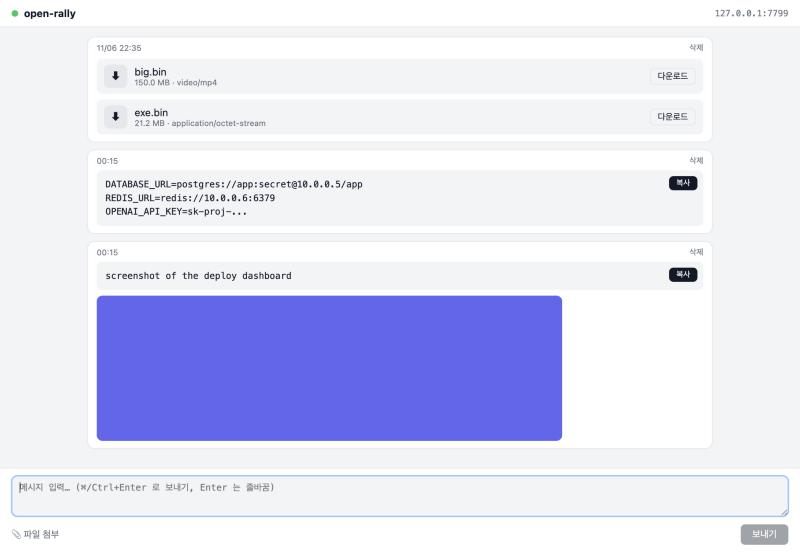

# open-rally

> A tiny, password-only shared board for passing secrets and files between your own machines over LAN or Tailscale. One Rust binary, no accounts, no cloud.

[](LICENSE)
[](https://www.rust-lang.org)

[한국어 README](README.ko.md)



## Why

You manage several PCs. You need to move a `.env`, an API key, a build artifact or a screen recording from one to another. Slack and messengers want a login on every box. AirDrop only works between Apple devices. Scp needs keys and paths.

open-rally is the thing in between: a web page every machine on your private network can open, with one shared password you type once per machine. Paste text, drop files, copy or download on the other side.

## Features

- **Text, images, video and arbitrary files** in one chronological board. Text keeps its whitespace and has a one-click copy button; images preview inline; videos play inline when the browser can decode them; everything else is a download card.
- **Live updates** over WebSocket. Post on one PC, see it on the others without refreshing.
- **One shared password**, remembered per browser for 30 days. No accounts.
- **Single binary.** The web UI is embedded; the only runtime dependency is SQLite, which is bundled.
- **macOS menubar app** to switch the server on and off. When it is off, nothing listens and nothing is used.
- **Docker image** for an always-on host (NAS, home server, Docker Desktop).
- **Private by default.** Binds to the Tailscale interface and localhost only; exposing to the LAN is an explicit toggle. Host/Origin allowlists block CSRF and DNS rebinding from the browsers that use it.
- **Streaming uploads.** A 1 GB video does not cost 1 GB of RAM.

## Quick start

### macOS menubar app

```bash
git clone https://github.com/GenesisSam/open-rally.git
cd open-rally
bash scripts/bundle-app.sh       # cargo build --release + dist/open-rally.app
open dist/open-rally.app
```

A filled circle appears in the menu bar and the server starts. The menu shows the address to open from other machines and lets you copy it, open it, toggle the server, expose it to the LAN, or open the password file.

### Docker (always on)

```bash
docker build -t open-rally .
docker run -d --name open-rally --restart unless-stopped \
  -v open-rally-data:/data \
  -e OPEN_RALLY_PASSWORD='choose-a-password' \
  -p 100.100.100.100:7777:7777 \
  open-rally
```

Replace `100.100.100.100` with the host's Tailscale IP. The container itself listens on all interfaces, so the host-side bind address is what keeps it off the public LAN. A `docker-compose.yml` with the same setup is included.

### Server only, any OS

```bash
cargo run --release -- --serve          # Ctrl+C to stop; add --lan to expose to the LAN
cargo build --release --no-default-features   # headless binary without the tray dependencies
```

## Using it

1. On another machine, open `http://<tailscale-ip>:7777`.
2. Enter the password. It is in `config.toml` in the data folder (see below), or in `OPEN_RALLY_PASSWORD` if you set it.
3. Type or paste text, press **⌘/Ctrl + Enter**. Drag files anywhere on the page, paste an image from the clipboard, or use the attach button.
4. On the receiving side, hit **Copy** on a text post or **Download** on a file. Posts stay until you delete them.

## Configuration

| Variable | Default | Meaning |
|---|---|---|
| `OPEN_RALLY_PORT` | `7777` | Listening port |
| `OPEN_RALLY_DATA_DIR` | `~/Library/Application Support/open-rally` (macOS), `~/.local/share/open-rally` (Linux), `%APPDATA%\open-rally` (Windows), `/data` (Docker) | Where the database, uploads and `config.toml` live |
| `OPEN_RALLY_PASSWORD` | unset | If set, used instead of `config.toml` |

The data folder contains `open-rally.db` (SQLite), `uploads/<post-id>/<filename>` and `config.toml` with a single `password = "..."` line. A random password is generated on first run. Change it and restart the server to apply.

## Security model

This is a tool for one person's private network, not a public service. Know what it does and does not do:

- **Network scope.** By default the server binds to `127.0.0.1` and the Tailscale interface (`100.64.0.0/10`). "Expose to LAN" binds to `0.0.0.0` until the app is restarted. There is no mode that exposes it to the internet.
- **Password.** One shared password, compared in constant time. Five wrong attempts block that IP for 10 seconds. Sessions are random 256-bit tokens kept in memory, so restarting the server logs everyone out.
- **Transport.** Plain HTTP. The password stops someone on the same network from stumbling in; it does not stop someone capturing packets. That is why Tailscale is the default.
- **Browser-side attacks.** Every request must carry a `Host` header in the private/Tailscale/`.local`/`.ts.net` allowlist (otherwise `421`), and state-changing requests with an `Origin` header must come from an allowed origin (`403`). This blocks CSRF and DNS-rebinding from other tabs on the client machines.
- **Attachments.** Filenames are sanitised and never used to build paths from the URL. SVG, HTML and XHTML are always served as downloads with `nosniff`, so an uploaded file cannot run scripts in the board's origin.
- **Not in scope.** HTTPS, accounts, encryption at rest, rate limiting beyond login, audit logs.

## How it works

```
┌──────────────── one process ────────────────┐
│  tao event loop (main thread, menubar)      │
│      │ start / stop                          │
│  ServerController ──► tokio runtime         │
│      axum router: /, /api/*, /files/*, /ws  │
│      rusqlite  ·  uploads/ on disk          │
└─────────────────────────────────────────────┘
```

- `src/server/` — router, middleware (host, origin, session), routes, WebSocket fan-out, `ServerController` (bind, graceful stop with a 5 s cap).
- `src/db.rs` — two tables, `posts` and `attachments`, ULID keys so ordering is just `ORDER BY id`.
- `src/files.rs`, `src/net.rs`, `src/auth.rs` — pure functions with unit tests: filename rules, allowlists, sessions and rate limiting.
- `src/tray.rs` — the menubar app, behind the `tray` cargo feature.
- `assets/` — the whole frontend: one HTML file, one stylesheet, one script, no build step, no inline scripts (CSP).

The design and the implementation plan that produced this code are in [`docs/superpowers/`](docs/superpowers/).

## Development

```bash
cargo test                          # unit + API + real-socket WebSocket tests
cargo test --no-default-features    # same, without the tray
cargo run -- --serve                # dev server; open http://127.0.0.1:7777
```

Integration tests run the real router through `tower::oneshot` and a real listener for WebSocket, with a temp directory per test. No mocks.

## Contributing

Issues and pull requests are welcome. See [CONTRIBUTING.md](CONTRIBUTING.md) for how to set up, what a good PR looks like and the few rules the project keeps (tests first, no new runtime dependencies without a reason, security defaults stay conservative).

## License

[MIT](LICENSE)
